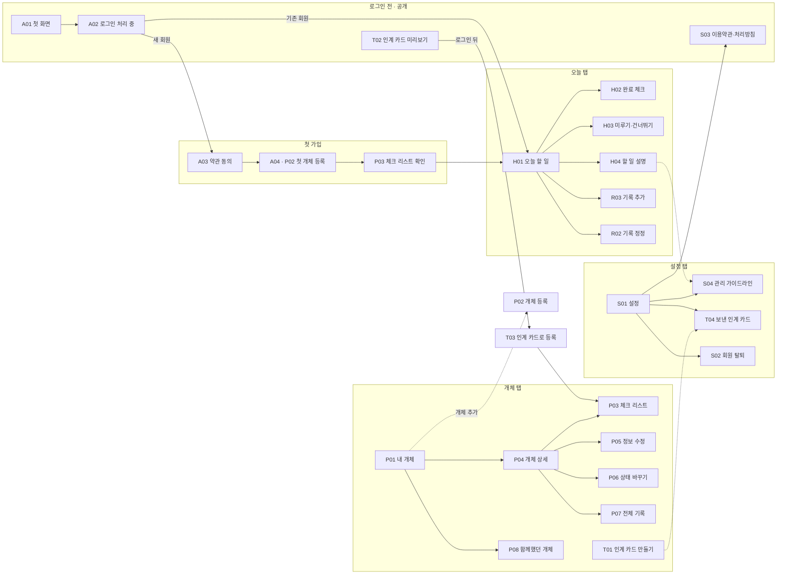
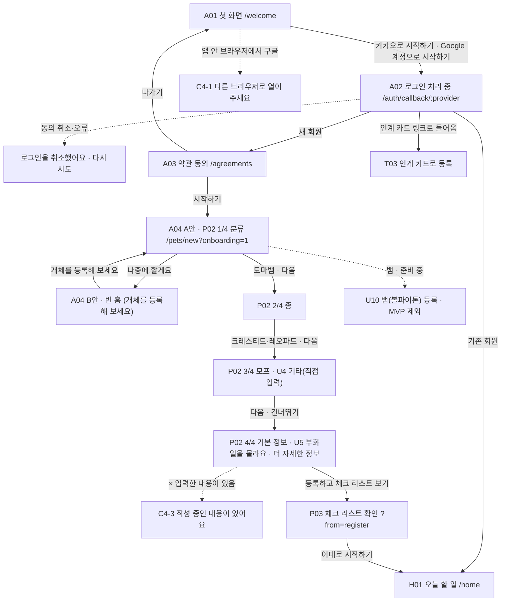
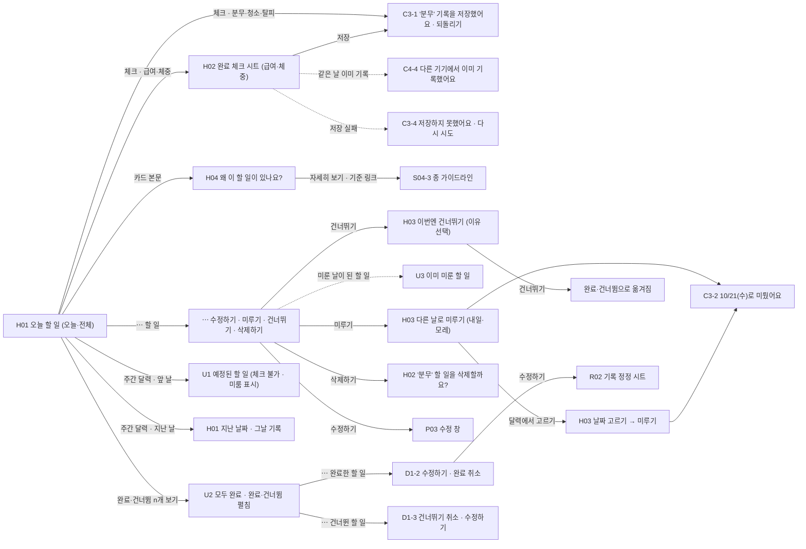
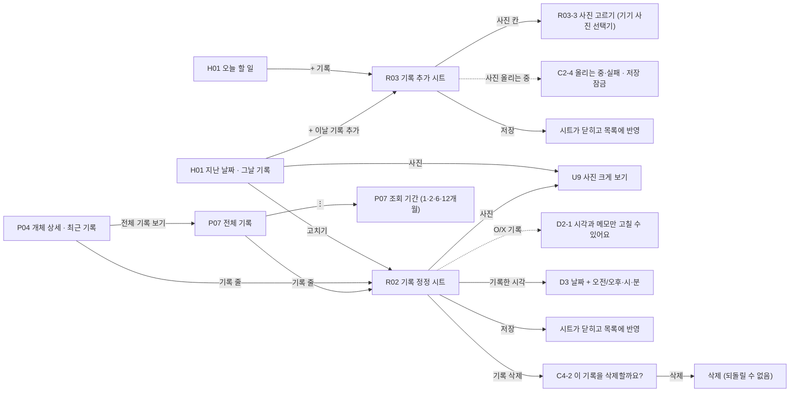
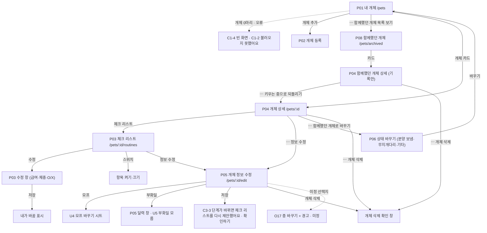
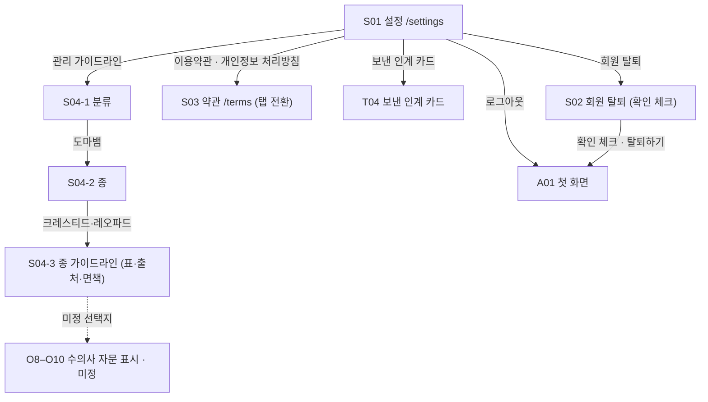
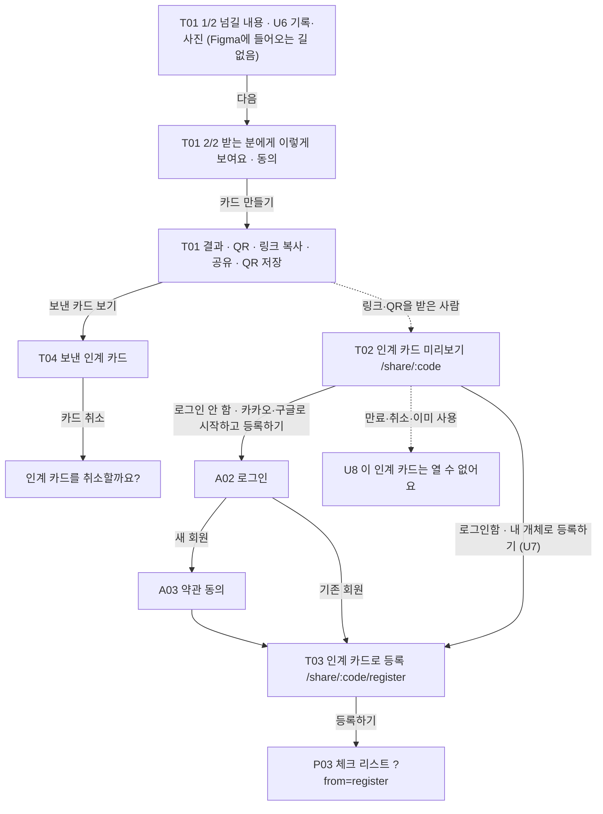
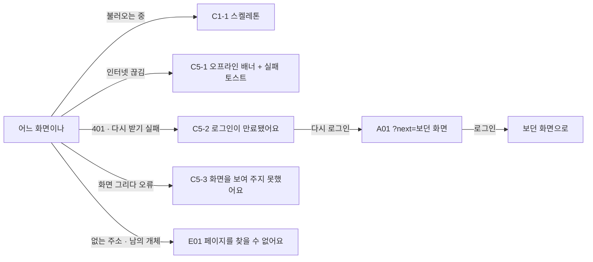

# 화면 흐름과 API 연결

Figma `PABOM 와이어프레임 v0.6`(node 2003:484)과 IA 시트(`PABOM_IA_20261005` 8_개발 참고)를 기준으로 정리했다.
백엔드(dev.api.pabom.app)에 있는 API(아래 표 '연결: 개발 서버')는 Next 프록시를 거쳐 진짜로 부르고,
아직 없는 API는 MSW(`src/mocks`)가 응답한다. 설정은 README '시작하기'·'로그인' 참고.

## 흐름

화살표 글자는 누르는 버튼 이름이다. 점선은 조건에 따라 가는 길이다. 화면 위에 뜨는 시트·창·토스트도 같은 그림에 넣었다.

### 전체 지도

### 1. 처음 들어오기

FL-01 · FL-10 · A01–A04 · P02 · P03 · U4 · U5 · C4-1 · C4-3

### 2. 매일 할 일

FL-02 · FL-03 · H01–H04 · U1–U3 · D1 · C3 · C4-4

### 3. 기록 남기고 고치기

FL-04 · FL-05 · R02 · R03 · D2 · D3 · U9 · C4-2

### 4. 개체 돌보기

FL-06 · FL-09 · P01–P08 · U4 · U5 · C1 · C3-3

### 5. 설정·계정

S01–S04 · T04

### 6. 인계 카드 (2차)

FL-09 · FL-10 · T01–T04 · U6–U8

### 7. 문제가 생겼을 때

E01 · C1 · C5

## 화면 목록 (Figma 섹션 44개)

QA는 개발 서버(목업 API)에서 375×812로 직접 눌러 확인했다. 통과 = Figma와 같음, 고침 = QA에서 고친 뒤 다시 확인, 다름 = 이유가 있어 Figma와 다르게 둠, 범위 밖 = 만들지 않음·미정.

| 묶음            | Figma  | 화면                         | 프레임                                              | 경로                                                        | QA      |
| --------------- | ------ | ---------------------------- | --------------------------------------------------- | ----------------------------------------------------------- | ------- |
| 진입·계정       | A01    | 첫 화면                      | 기본                                                | `/welcome`                                                  | 고침    |
| 진입·계정       | A02    | 로그인 처리 중               | 기본                                                | `/auth/callback/[provider]`                                 | 통과    |
| 진입·계정       | A03    | 약관 동의                    | 기본                                                | `/agreements`                                               | 고침    |
| 진입·계정       | A04    | 첫 개체 등록 시작            | A안 약관 후 바로 등록 · B안 홈 빈 자리              | `/pets/new?onboarding=1` · `/home`                          | 통과    |
| 개체 등록       | P02    | 개체 등록                    | 1/4 분류 · 2/4 종 · 3/4 모프 · 4/4 기본 정보 · 펼침 | `/pets/new`                                                 | 고침    |
| 개체 등록       | U4     | 모프 기타 입력               | 등록 3/4 · 정보 수정 시트                           | `/pets/new` · `/pets/[id]/edit`                             | 고침    |
| 개체 등록       | U5     | 부화일 모름                  | 등록 4/4 · 정보 수정                                | `/pets/new` · `/pets/[id]/edit`                             | 고침    |
| 개체 등록       | U10    | 뱀(볼파이톤) 등록            | 1/3 분류 · 2/3 모프 · 3/3 기본 정보                 | —                                                           | 범위 밖 |
| 개체 등록       | P03    | 체크 리스트 확인·수정        | 기본 · 수정 창 급여·체중·O/X                        | `/pets/[id]/routines`                                       | 고침    |
| 오늘            | H01    | 오늘 할 일(홈)               | 오늘·전체 · 지난 날짜                               | `/home`                                                     | 통과    |
| 오늘            | U1·U2  | 앞 날짜 · 모두 완료          | 앞 날짜 · 모두 완료 펼침                            | `/home`                                                     | 고침    |
| 오늘            | H02    | 완료 체크·할 일 메뉴         | 급여 시트 · 체중 시트 · ⋯ 메뉴 · 삭제 확인 창       | `/home (시트)`                                              | 다름    |
| 오늘            | H03    | 미루기·건너뛰기 시트         | 미루기 · 달력에서 고르기 · 건너뛰기                 | `/home (시트)`                                              | 고침    |
| 오늘            | U3     | 이미 미룬 할 일              | H03                                                 | `/home (시트)`                                              | 통과    |
| 오늘            | H04    | 할 일 설명 시트              | 접힘 · 펼침                                         | `/home (시트)`                                              | 다름    |
| 기록            | R03    | 기록 추가 시트               | 체중 · 메모+사진 · 사진 고르기 창                   | `/home (시트)`                                              | 고침    |
| 기록            | R02    | 기록 정정 시트               | 기본                                                | 홈·개체 상세·전체 기록 (시트)                               | 통과    |
| 기록            | U9     | 사진 크게 보기               | P07에서 · R02에서                                   | (전체 화면 창)                                              | 고침    |
| 기록            | D2     | 기록 폼                      | O/X 정정 · 값 칸 4종                                | R02·R03                                                     | 고침    |
| 기록            | D3     | 날짜·시각 고르기             | 날짜 + 시각                                         | R02 (시트)                                                  | 고침    |
| 개체            | P01    | 내 개체 목록                 | 기본 · ⋯ 메뉴                                       | `/pets`                                                     | 고침    |
| 개체            | P08    | 함께했던 개체                | 기본 · 카드→상세 · ⋯                                | `/pets/archived`                                            | 통과    |
| 개체            | P04    | 개체 상세                    | 기본 · ⋯ 메뉴                                       | `/pets/[id]`                                                | 다름    |
| 개체            | P06    | 개체 상태 바꾸기 시트        | 함께했던 개체로 바꾸기                              | `/pets/[id] (시트)`                                         | 통과    |
| 개체            | P07    | 전체 기록                    | 기본 · 조회 기간 시트                               | `/pets/[id]/records`                                        | 고침    |
| 개체            | P05    | 개체 정보 수정·삭제          | 기본 · 달력 창                                      | `/pets/[id]/edit`                                           | 통과    |
| 개체            | O17    | 종을 잘못 고른 사람 (선택지) | 현재 기본안 · 종 바꾸기 + 경고                      | —                                                           | 범위 밖 |
| 설정            | S01    | 설정(계정 메뉴)              | 기본                                                | `/settings`                                                 | 통과    |
| 설정            | S04    | 관리 가이드라인              | 1 분류 · 2 종 · 3 종 가이드라인                     | `/settings/guidelines` · `/settings/guidelines/[speciesId]` | 통과    |
| 설정            | O8–O10 | 수의사 자문 표시 (선택지)    | 현재 기본안 · O8 · O9 · O10                         | —                                                           | 범위 밖 |
| 설정            | S03    | 이용약관·개인정보 처리방침   | 기본                                                | `/terms` · `/terms?tab=privacy`                             | 통과    |
| 설정            | S02    | 회원 탈퇴                    | 체크한 뒤                                           | `/settings/withdraw`                                        | 통과    |
| 인계 카드 (2차) | T01    | 인계 카드 만들기             | 1/2 넘길 내용 · 2/2 확인·동의 · 결과·공유           | `/pets/[id]/handover`                                       | 통과    |
| 인계 카드 (2차) | T02    | 인계 카드 미리보기           | 기본(로그인 안 함)                                  | `/share/[token]`                                            | 고침    |
| 인계 카드 (2차) | T03    | 인계 카드로 개체 등록        | 기본                                                | `/share/[token]/register`                                   | 통과    |
| 인계 카드 (2차) | T04    | 보낸 인계 카드 관리          | 기본                                                | `/settings/handover-cards`                                  | 통과    |
| 인계 카드 (2차) | U6–U8  | 인계 카드 고유 장면          | 기록·사진 넘김 · 로그인 함 · 링크 사용 불가         | `/pets/[id]/handover` · `/share/[token]`                    | 통과    |
| 공통 부품·상태  | C1     | 데이터 상태                  | 로딩 · 화면 오류 · 영역 오류 · 빈 화면              | 여러 화면                                                   | 다름    |
| 공통 부품·상태  | C2     | 제출·입력 상태               | 비활성 · 저장 중 · 값 고르기 전 · 사진 올리는 중    | 여러 화면                                                   | 고침    |
| 공통 부품·상태  | C3     | 토스트                       | 성공+되돌리기 · 성공 · 성공+행동 · 오류+다시 시도   | 여러 화면                                                   | 통과    |
| 공통 부품·상태  | C4     | 창                           | 확인 · 삭제(빨강) · 나가기 · 안내(버튼 1개)         | 여러 화면                                                   | 고침    |
| 공통 부품·상태  | D1     | 할 일 카드                   | 4상태 · ⋯ 완료 · ⋯ 건너뜀                           | `/home`                                                     | 통과    |
| 공통 부품·상태  | C5     | 전역 상황                    | 오프라인 배너 · 세션 만료 창 · 오류 경계            | 모든 화면                                                   | 통과    |
| 공통 부품·상태  | E01    | 오류·오프라인·없는 페이지    | 기본                                                | not-found · error                                           | 통과    |

화면은 Figma 그대로 둔다. Figma에 없는 줄·안내·메뉴·확인 창·토스트는 넣지 않고, 들어오는 길이 Figma에 없는 화면(T01 인계 카드 만들기, T04 보낸 인계 카드)은 화면만 있다. Figma에 화면이 없는 상황(빈 목록·불러오기 실패·저장 실패)은 공통 상태 C1·C3 모양을 쓴다. 예외: R03 사진 고르기는 웹이라 기기 사진 선택기, U10 뱀은 MVP 범위 밖이라 카드·줄은 있지만 고를 수 없다. O17·O8–O10은 Figma에서 미정인 선택지라 현재 기본안을 유지한다.

## API (IA 8_개발 참고 기준, 경로 앞에 `/api/v1`)

| ID     | 메서드·경로                        | 화면              | 연결                                                 |
| ------ | ---------------------------------- | ----------------- | ---------------------------------------------------- |
| API-01 | GET /auth/{provider}/login-url     | A01               | 개발 서버                                            |
| API-01 | GET /auth/{provider}/callback      | A02               | 개발 서버                                            |
| API-02 | POST /auth/refresh                 | 모든 화면(401 때) | 개발 서버                                            |
| API-03 | POST /auth/logout                  | S01               | 개발 서버                                            |
| API-04 | GET /me                            | 진입 분기·S01     | 목업                                                 |
| API-05 | POST /me/agreements                | A03               | 개발 서버                                            |
| API-07 | DELETE /me                         | S02               | 목업                                                 |
| API-10 | GET /species                       | P02·S04           | 개발 서버 (`species`, 로그인 없이)                   |
| -      | GET /species/{id}/morphs           | P02·P05           | 개발 서버 (`species`, 로그인 없이)                   |
| API-11 | GET /species/{id}/care-standards   | H04·S04           | 목업                                                 |
| API-20 | GET /pets                          | P01·P08·H01       | 개발 서버 (`pets`). 함께했던 개체·할 일 수는 임시 값 |
| API-21 | POST /pets                         | P02               | 개발 서버 (`pets`). 등록만, 일정 생성 안 함          |
| API-22 | GET /pets/{id}                     | P04               | 개발 서버 (`pets`). 체크 리스트·기록은 목업만        |
| API-23 | PATCH /pets/{id}                   | P05               | 개발 서버 (`pets`)                                   |
| API-24 | DELETE /pets/{id}                  | P05·P08           | 목업                                                 |
| API-26 | POST /pets/{id}/status-changes     | P06·P08           | 목업                                                 |
| API-30 | GET /pets/{id}/routines            | P03·H04           | 목업                                                 |
| API-31 | PATCH /routines/{id}               | P03·H01           | 목업                                                 |
| API-32 | POST /routines/{id}/reset          | P03               | 목업                                                 |
| API-40 | GET /today                         | H01               | 목업                                                 |
| API-41 | POST /routines/{id}/complete       | H01·H02           | 목업                                                 |
| API-42 | POST /routines/{id}/skip           | H03               | 목업                                                 |
| API-43 | POST /routines/{id}/postpone       | H03               | 목업                                                 |
| API-50 | GET /records                       | H01·P07           | 목업                                                 |
| API-51 | POST /records                      | R03               | 목업                                                 |
| API-52 | GET /records/{id}                  | R02               | 목업                                                 |
| API-53 | PATCH /records/{id}                | R02               | 목업                                                 |
| API-54 | DELETE /records/{id}               | H01·R02           | 목업                                                 |
| API-55 | POST /records/{id}/restore         | R02 되돌리기      | 목업                                                 |
| API-60 | POST /files                        | R03·P02·P05       | 목업 (백엔드 있음, 개체·기록 API가 생기면 연결)      |
| API-80 | POST /handover-cards               | T01               | 목업                                                 |
| API-81 | GET /handover-cards/{code}         | T02·T03           | 목업                                                 |
| API-82 | POST /handover-cards/{code}/accept | T03               | 목업                                                 |
| API-83 | GET /handover-cards                | T04               | 목업                                                 |
| API-84 | DELETE /handover-cards/{code}      | T04               | 목업                                                 |

신고(API-70~75, SCR-L01~L05)는 Figma에 아직 화면이 없어서 이번 범위에서 뺐다.

## 실제 API로 바꾸는 법

1. 백엔드 Swagger(`https://dev.api.pabom.app/v3/api-docs`)의 응답 모양을 `src/shared/domain/*.ts` zod 스키마와 맞춘다. 화면은 스키마 타입만 본다. 성공 응답이 `{resultType, success:{data}}`로 감싸져 오면 `successEnvelope`로 푼다.
2. `src/shared/api/endpoints.ts`가 경로·메서드를 한곳에 모아 둔다. 경로가 다르면 여기만 고친다. orval로 생성하게 되면 이 파일의 함수를 생성된 함수로 바꾸면 된다.
3. 목업 핸들러를 같은 모양으로 고치고(`src/mocks/handlers.ts`), 그 묶음을 `NEXT_PUBLIC_API_LIVE`에 넣는다. 다 옮기면 `NEXT_PUBLIC_API_MOCKING=disabled`.
4. 로그인은 백엔드가 카카오·구글 주소를 만들어 준다. 백엔드 Redirect URI만 이 앱의 `/api/v1/auth/{provider}/callback`으로 맞추면 된다 (README '로그인').
